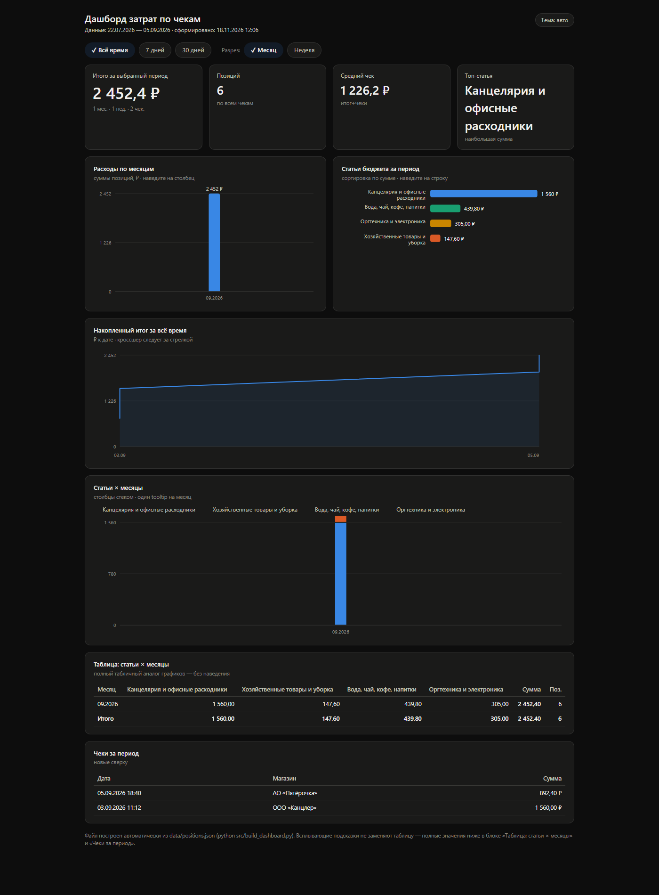
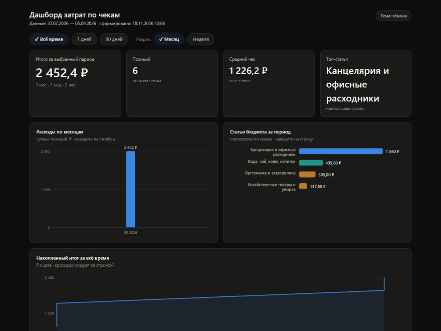

# Автоматизация учёта расходов: разнос кассовых чеков по статьям бюджета

Готовая система для учёта расходов семьи или команды: фотографируешь чек в Telegram —
система сама берёт из него позиции, раскладывает по статьям бюджета и строит отчёты
(Excel, CSV, HTML-дашборд). Расход без чека добавляется сообщением вида
`500 обед при встрече`.





Это **комплект для развёртывания с нуля**: код, справочник статей, скрипты установки,
инструкция и скилл для Claude Code (см. раздел в конце).

## Как это работает (жизненный цикл чека)

```
фото чека в Telegram → receipts/ → QR-код → API ФНС → позиции → отчёты
                                                    ↑ резерв: PDF / OCR с картинки
```

1. Участник группы отправляет боту фото или PDF чека; бот складывает файл в
   `receipts/` и запускает конвейер.
2. Конвейер готовит изображение (разворот по EXIF, поиск QR-кода): из QR берутся
   фискальные признаки (дата, сумма, ФД, ФПД), и по ним у сервиса детализации
   запрашивается официальная детализация позиций (API ФНС через proverkacheka.com).
3. Если QR не читается — PDF-чеки парсятся текстовым слоем, изображения — локальным
   OCR (Tesseract), результат помечается для проверки.
4. Каждая позиция относится к статье бюджета по ключевым словам из
   `config/categories.json`; нераспознанные попадают в лист «Требует разметки».
5. Пересобираются `reports/` (CSV-снимок) и HTML-дашборд; бот присылает статус.

Дубликаты отсекаются по SHA-256 — повторно присланный чек не задваивается.

## Установка с нуля (Windows)

Пошагово с пояснениями каждого шага — в [`Установка-чеки-инструкция.md`](Установка-чеки-инструкция.md).
Короткий список:

1. **Python 3.12+** — [python.org/downloads](https://www.python.org/downloads/) (при установке отметить «Add to PATH»).
2. **Библиотеки** — в папке проекта:
   ```powershell
   pip install -r deploy\requirements.txt
   ```
3. **Tesseract OCR** (для распознавания с картинки, если QR не читается):
   `winget install UB-Mannheim.TesseractOCR` — данные для русского уже лежат в `tessdata/`.
4. **Токены** — скопировать шаблоны и вписать свои значения (реальные конфиги с токенами в репозиторий не попадают — они в `.gitignore`):
   - скопируй `config/telegram.json.example` → `config/telegram.json` и впиши в поле `token` токен бота от [@BotFather](https://t.me/BotFather) (`/newbot`);
   - скопируй `config/proverkacheka.json.example` → `config/proverkacheka.json` и впиши `api_token` с [proverkacheka.com](https://proverkacheka.com)
     (бесплатно ~15 детализаций в сутки).
5. **Запуск**: `python src/telegram_bot.py`, в чате с ботом — `/start`, дальше присылать чеки.
6. **Автозапуск при входе в Windows**: двойной клик по `scripts/setup_autostart.bat`.

## Быстрый старт без бота (только конвейер)

```powershell
# чеки (JPG/PNG/PDF) положить в receipts/
python src/prepare_receipts.py        # подготовка изображений + чтение QR
python src/run_pipeline.py            # позиции → отчёт → дашборд
python src/build_report.py --demo    # проверка системы на демо-данных
python src/build_dashboard.py        # пересобрать только дашборд
python src/ingest.py --from "C:\путь\к\папке\с\чеками" --move --run  # приём из любой папки
```

## Команды бота

| Команда | Действие |
|---|---|
| `/start` | инструкция |
| `/status` | сколько чеков принято + расход лимита API |
| `/add 500 обед при встрече` | расход **без чека**: сумма + описание (статья по описанию) |
| `/report` | свежий Excel-отчёт файлом (занят Excel — пришлёт CSV) |
| `/dash` | пересобрать и прислать HTML-дашборд |
| `/run` | пересобрать отчёт из текущих данных |

## Структура комплекта

```
src/                        код (Python)
  telegram_bot.py           Telegram-бот: приём чеков, команды, группы доступа
  ingest.py                 приёмник файлов с дедупликацией по SHA-256
  run_pipeline.py           конвейер: подготовка → positions.json → отчёт → дашборд
  prepare_receipts.py       EXIF-разворот, уменьшение, чтение QR-кодов
  fetch_detail.py           детализация позиций через API ФНС (лимит 15/сутки)
  parse_pdf.py              разбор PDF-чеков с текстовым слоем
  extract_items.py          OCR-распознавание позиций (резервный путь)
  build_report.py           Excel-отчёт (5 листов) + CSV-снимок
  build_dashboard.py        HTML-дашборд (тренды, статьи, фильтры)
  access_audit.py           аудит изоляции групп доступа
  self_test.py              самопроверка конвейера
config/
  categories.json           справочник статей + ключевые слова
  access.json               группы доступа: кто к какой группе относится
  telegram.json.example     шаблон токена бота        (от @BotFather, /newbot)
  proverkacheka.json.example  шаблон токена детализации (proverkacheka.com)
tessdata/                   языковые данные Tesseract (рус, англ)
scripts/                    автозапуск под Windows (setup_autostart.bat и др.)
deploy/                     развёртывание на сервере: Fly.io, Oracle, Google Cloud
                            + подробные README_*.md для каждого облака
Docs/                       шпаргалки (добавление человека в группу)
Установка-чеки-инструкция.md  пошаговая установка на Windows
SKILL.md                    скилл для Claude Code — как Claude помогает с проектом
```

Рабочая папка создаётся автоматически: `receipts/` (чека на входе), `data/`
(`positions.json` — источник правды), `reports/` (CSV + `Дашборд.html`), `logs/`.

## Формат данных (`data/positions.json`)

Источник правды по всем позициям. Можно править руками, после правки запустить
`python src/run_pipeline.py` или `/run` в боте.

```json
{
  "receipts": [
    { "receipt_id": "R-001", "datetime": "2026-09-03 11:12",
      "shop": "ООО «Канцлер»", "inn": "7701234567", "total": 1560.00, "method": "qr" }
  ],
  "items": [
    { "receipt_id": "R-001", "name": "Бумага офисная А4 500 л.",
      "qty": 2, "price": 380.00, "sum": 760.00, "category": "KANC", "comment": "" }
  ]
}
```

`category` можно не указывать — статья определится по ключевым словам; явное значение
оператора имеет приоритет.

## Группы доступа

Бот работает с несколькими Telegram-аккаунтами; принадлежность задаётся в
`config/access.json` (см. пример в файле): `users` — числовые chat_id,
`usernames` — без @. Аккаунт видит и управляет **только своей группой**: свои чеки,
свои позиции, свои отчёты. Незнакомый аккаунт получает отказ со своим chat_id —
владелец вписывает его в конфиг. Шпаргалка: `Docs/Как добавить чела в группу`.

Квота детализации — общая на всех (`data/api_quota.json`), при исчерпании бот
продолжает принимать чеки в очередь и разбирает их после возобновления лимита
(00:00 МСК); очередь не теряется.

## Листы Excel-отчёта

| Лист | Содержание |
|---|---|
| Сводка | период, суммы и доли по статьям, разбивки по месяцам и ISO-неделям |
| Позиции | каждая позиция: дата, магазин, ИНН, кол-во, цена, сумма, статья |
| Чеки | сверка итога чека с суммой позиций (расхождения подсвечены) |
| Требует разметки | позиции без найденной статьи |
| Справочник статей | коды, названия, ключевые слова |

CSV-снимок `reports/Отчёт_затрат_*.csv` пересобирается конвейером всегда;
XLSX-файл бот присылает по `/report` в момент запроса. Даты пишутся готовым текстом
`ДД.ММ.ГГГГ` — так вьюеры Apple не искажают формат (`?theme=light|dark`,
`?agg=week` — параметры ссылки дашборда).

## Развёртывание на сервере (бот 24/7 без вашего ПК)

Готовые конфигурации в `deploy/`:

- **Oracle Cloud Always Free** (бесплатно навсегда, VM A1.Flex 2 OCPU/12 ГБ) —
  `README_Oracle.md` + установщик `oracle_install.sh` одним запуском (systemd,
  автоперезапуск, ежедневные бэкапы, анти-реклайн-крон).
- **Fly.io** (~$2–4/мес + том) — `README_Fly.md`, Dockerfile, `fly.toml`.
- **Google Cloud e2-micro** (бесплатно в US-регионах) — `README_Google.md`.

Важно: на сервере токены задаются через переменные окружения/`/etc/receiptsbot.env`,
а не в конфигах; перед переездом остановите локального бота
(`schtasks /Delete /TN "ReceiptsBot" /F`), иначе два процесса поделят канал Telegram.

## Что требует донастройки

- Чеки ИП/самозанятых без детализации — доступна только общая сумма.
- Пересекающиеся категории («перчатки»: хозяйственные или СИЗ) — уточнять правилами
  приоритета в `categories.json`.
- Позиции из OCR помечаются флагом — выборочная проверка вручную.

## Скилл для Claude Code

`SKILL.md` в корне комплекта — упакованная инструкция, по которой Claude Code у нового
владельца проекта знает: как запускать конвейер, куда кладутся чеки, как править
справочник статей, как диагностировать типовые ошибки. Чтобы скилл работал:

1. Скопируйте `SKILL.md` в `<папка проекта>\.claude\skills\checks-automation\SKILL.md`.
2. Откройте Claude Code в папке проекта — скилл подхватится автоматически.

Без Claude Code система полностью самодостаточна — скилл лишь ускоряет поддержку.

## Ограничения и замечания

- proverkacheka.com — неофициальная надстройка над API ФНС (владелец домена
  не раскрывается); для юридически значимой детализации используйте API ФНС напрямую.
- Лимит бесплатной детализации ~15 чеков/сутки; снятие — платный тариф или удаление
  `data/api_quota.json` после ротации токена.
- Telegram long-polling не требует открытых портов — наружу сервер ничего не публикует.
